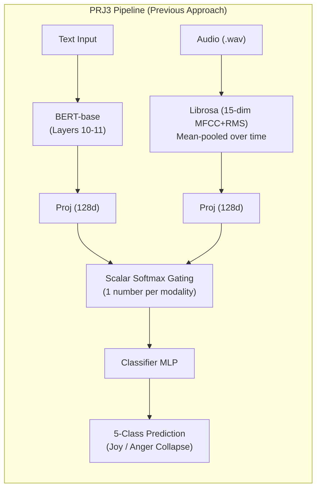
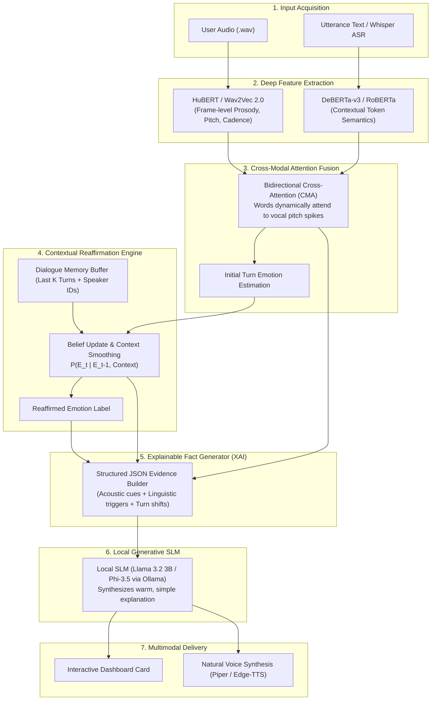
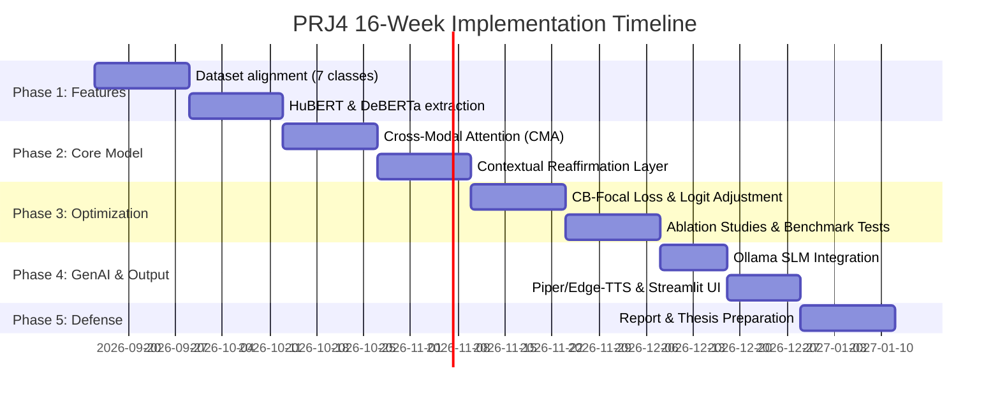

# Project Evolution Guide: From PRJ3 to PRJ4
**Multimodal Emotion Recognition & Explainable Assistive Agent**  
*Mentored by: Dr. Yogesh Gupta | BML Munjal University*  
*Team Members: Suhani Aggarwal (230547), Aditya Parecha (230522), Harsh Pratap Singh (230518)*

---

## 1. Executive Summary for the Team

In **Project-III (PRJ3)**, our team built the foundation: an end-to-end pipeline that takes speech and text, extracts features, and runs them through a dynamic softmax fusion network to predict emotions. 

However, deep evaluation of our training data and results revealed serious **fatal bottlenecks** in the PRJ3 model (including a complete **mode collapse** where the model predicted *Joy* and *Anger* almost exclusively, while scoring **0% on Sadness, Surprise, and Neutral**).

For **Project-IV (PRJ4)**, we are taking this project from a flawed, static classifier to a **production-ready, context-aware, and explainable multimodal assistive agent**. 

### The Core Vision in One Sentence:
> *Instead of an amnesic classifier that guesses emotions in a vacuum, PRJ4 listens with high-definition acoustic models, tracks conversation memory across turns, reaffirms emotions using context, explains **why** it detected that emotion using Explainable AI (XAI), and speaks that explanation aloud using a local LLM and Text-to-Speech.*

---

## 2. The Previous Approach (PRJ3 Baseline)

### Architecture Summary
* **Code Reference**: [`new.py`](file:///c:/Users/suhan/Desktop/PRJ4/new.py) | **Checkpoint**: [`best3.pt`](file:///c:/Users/suhan/Desktop/PRJ4/best3.pt)
* **Dataset**: MELD (Multimodal Emotion Lines in Dataset), filtered down from 7 emotions to 5 (`neutral`, `joy`, `anger`, `sadness`, `surprise`), discarding `fear` and `disgust`.
* **Text Pipeline**: `bert-base-uncased` with layers 0–9 frozen and layers 10–11 unfrozen for fine-tuning.
* **Audio Pipeline**: Librosa extracting **15 static features** (13 MFCCs averaged across time + 1 RMS energy value + 1 zero-padding).
* **Fusion Strategy**: Scalar Softmax Gating:
  $$w = \text{Softmax}\big([W_t(t), W_a(a)]\big), \quad F = w_1 t + w_2 a$$
* **Loss Function**: Standard Focal Loss ($\gamma=2$).
* **Utterance Processing**: Every utterance was processed in **complete isolation** (no conversation history or speaker tracking).



### Why PRJ3 Failed (The Data from Results)
When analyzing our result plots, three major flaws emerged:

1. **Severe Mode Collapse ([`RESULTS1.jpeg`](file:///c:/Users/suhan/Desktop/PRJ4/RESULTS1.jpeg))**:
   * The confusion matrix shows that the model predicted **`joy` (~50–61%)** and **`anger` (~39–50%)** across every single ground truth class.
   * `neutral`, `sadness`, and `surprise` had an effective prediction rate of **0.00**. Even genuine Neutral dialogues were misclassified as 61% Joy and 39% Anger.
2. **Per-Class Sensitivity Failure ([`results2.jpeg`](file:///c:/Users/suhan/Desktop/PRJ4/results2.jpeg) & [`results3.jpeg`](file:///c:/Users/suhan/Desktop/PRJ4/results3.jpeg))**:
   * Per-class F1 was ~0.25 for Anger, ~0.23 for Joy, ~0.005 for Neutral, and **0.00 for Sadness and Surprise**.
3. **The "Flattened Audio" Problem**:
   * Averaging MFCCs into 15 numbers stripped out all pitch trajectories, tremors, and voice speed.
   * Because the audio was so uninformative, the Multimodal model (F1: 63.26%) actually performed **worse** than Text-only BERT (F1: 63.44%).
4. **Conversational Amnesia**:
   * The model evaluated every utterance independently. It could not tell if someone said *"Fine"* after hearing a compliment or after a heated argument.

---

## 3. The New Approach (PRJ4: Full Assistive Agent)

PRJ4 redesigns the entire system around **7 integrated stages**:



### Key Innovations in PRJ4

#### Innovation 1: High-Definition Audio via Speech Foundation Models
* **Before**: 15 numbers from static MFCCs.
* **Now**: Pretrained **HuBERT** or **Wav2Vec 2.0**. It extracts frame-by-frame audio embeddings preserving intonation, pitch variation, vocal stress, and pauses.

#### Innovation 2: Bidirectional Cross-Modal Attention (CMA)
* **Before**: A scalar weight multiplied across the entire modality.
* **Now**: Audio and text attend to each other at the token/frame level. If a speaker sarcastically says *"Oh, great"*, the model aligns the word *"great"* directly to the flat, low-arousal acoustic energy, catching the sarcasm.

#### Innovation 3: Contextual Reaffirmation (The Conversation Tracker)
* **Before**: Amnesic single-turn predictions.
* **Now**: A sliding dialogue memory buffer (tracking the last $K=3-5$ turns + speaker IDs). 
  * The initial turn-level emotion prediction is passed through a **Contextual Reaffirmation Layer** (e.g., GRU or Graph Attention over turns) to account for *emotional inertia* (people don't switch from calm to enraged in 0.1s without stimulus) and *inter-speaker dynamics*.

#### Innovation 4: Solving Mode Collapse via Class-Balanced Loss & Calibration
* **Before**: Basic Focal Loss ($\gamma=2$) which allowed the model to cheat by only guessing Joy and Anger.
* **Now**:
  * Reinstate the full **7 MELD classes** (bringing back *Fear* and *Disgust*).
  * **Class-Balanced Focal Loss (CB-Focal)** weighted by effective sample counts.
  * **Post-hoc Logit Adjustment**: Adjusting output probabilities by $-\tau \log(\pi_c)$ so minority emotions have a mathematically fair chance of being predicted.

#### Innovation 5: Explainable AI (XAI) Fact Extraction
* The model compiles an auditable, structured reasoning packet before any text is shown to the user:
```json
{
  "reaffirmed_emotion": "Frustration / Passive Anger",
  "confidence": 0.88,
  "acoustic_cues": "Pitch variance increased by 42%; speech tempo spiked to 195 WPM on final clause",
  "linguistic_cues": "Use of dismissive discourse marker ('Whatever you say')",
  "contextual_shift": "Shifted from Neutral to Frustrated following Speaker B's interruption in Turn 4"
}
```

#### Innovation 6: Edge Generative Translation (Local SLM)
* We do **not** use the LLM to guess the emotion (LLMs are prone to hallucinating emotions).
* Instead, our specialized multimodal model computes the facts, and a fast, private, local model (**Llama-3.2-3B** or **Phi-3.5** via **Ollama**) translates those technical facts into simple, compassionate language:
  > *"It sounds like Alex is feeling frustrated. While their words were polite, their tone of voice became noticeably sharper, reacting to the disagreement a moment ago."*

#### Innovation 7: Spoken Multimodal Feedback (Local TTS)
* The simplified text is converted back to natural human speech using a lightweight local engine (**Edge-TTS** or **Piper TTS**), providing audio-visual feedback in real time.

---

## 4. Side-by-Side Comparison: PRJ3 vs PRJ4

| Aspect | PRJ3 (Previous Approach) | PRJ4 (Upgraded Approach) | Why This Matters for the Team |
| :--- | :--- | :--- | :--- |
| **Acoustic Backbone** | Librosa 13 MFCC + RMS (15 static numbers) | Pretrained **HuBERT / Wav2Vec 2.0** (Frame-level) | Gives the model "ears" that can actually hear pitch, tone, and inflection. |
| **Linguistic Backbone** | `bert-base-uncased` (partial freeze) | **DeBERTa-v3-base** | Superior disentangled attention for understanding sarcasm, irony, and conversational nuances. |
| **Fusion Technique** | Linear projection + Scalar Softmax Gating | **Bidirectional Cross-Modal Attention (CMA)** | Synchronizes the exact word spoken with the exact vocal inflection used. |
| **Context Handling** | None (1 utterance evaluated in total isolation) | **Dialogue Memory Buffer & Context Reaffirmation** | Understands conversational trajectory, speaker relationships, and emotional inertia. |
| **Emotion Classes** | 5 classes (`fear` and `disgust` deleted) | Full **7 MELD classes** (plus IEMOCAP testing) | Standard benchmark adherence; proves real-world generalization. |
| **Class Imbalance Strategy** | Basic Focal Loss (resulted in severe mode collapse) | **Class-Balanced Focal Loss + Logit Adjustment** | Forces the model to learn Sadness, Surprise, Fear, and Disgust instead of cheating on Joy/Anger. |
| **Interpretability (XAI)** | None (Black-box neural network) | **Structured Evidence Extraction** | Provides clear justification for every prediction (crucial for professor defense). |
| **Generative Delivery** | Raw classification labels on a basic UI | **Local SLM (Llama 3.2 3B) + Real-time TTS** | Transforms a machine learning model into a helpful, interactive assistive agent. |

---

## 5. Step-by-Step Implementation Roadmap



### Stage 1: Data Preparation & Feature Extraction
1. Load full MELD dataset with all 7 emotions (`neutral`, `joy`, `anger`, `sadness`, `surprise`, `fear`, `disgust`).
2. Implement audio feature caching script: run audio wavs through `facebook/hubert-base-ls960` to cache frame embeddings.
3. Tokenize utterances using `microsoft/deberta-v3-base`.

### Stage 2: Cross-Modal Model Development
1. Build the **Cross-Modal Attention (CMA)** layer:
   * Query ($Q$) from text, Key/Value ($K, V$) from audio, and vice versa.
2. Build the **Context Tracker**:
   * Use a small Bi-GRU or Dialogue Transformer over the conversation's turn sequences.
3. Train with **Class-Balanced Focal Loss** and evaluate on the test split to verify that all 7 classes have non-zero F1 scores.

### Stage 3: Explainability & Local LLM Integration
1. Write the **Fact Extraction Module**: calculates attention weights to identify top acoustic features and top text tokens.
2. Set up **Ollama** locally with `llama3.2:3b` or `phi3.5:mini`.
3. Create the prompt template that formats the extracted facts and requests a 2-sentence conversational explanation.

### Stage 4: Text-to-Speech & Real-Time Interface
1. Integrate **Edge-TTS** or **Piper-TTS** in Python to generate `.wav` audio of the explanation.
2. Build the **Streamlit / Web App**:
   * Audio recorder widget (or file upload).
   * Live timeline showing the emotion shift over turns.
   * Audio player playing the spoken explanation.

---

## 6. Suggested Team Task Division

To ensure smooth progress across all three team members:

* **Suhani Aggarwal**:
  * Lead on **Feature Extraction & Foundation Models** (HuBERT/Wav2Vec 2.0 audio pipeline + DeBERTa-v3 text pipeline).
  * Implementation of the **Cross-Modal Attention (CMA)** fusion network.
* **Aditya Parecha**:
  * Lead on **Contextual Modeling & Dialogue State Tracking** (Turn history buffer, emotional inertia modeling).
  * Loss function engineering (Class-Balanced Focal Loss, temperature scaling, logit adjustment) to eliminate mode collapse.
* **Harsh Pratap Singh**:
  * Lead on **Explainability & Generative Pipeline** (XAI fact builder, local Ollama SLM integration).
  * Frontend dashboard development (Streamlit / FastAPI) and low-latency **Text-to-Speech (TTS)** deployment.

---

*This document serves as the internal specification and blueprint for our PRJ4 capstone submission and development cycle.*
